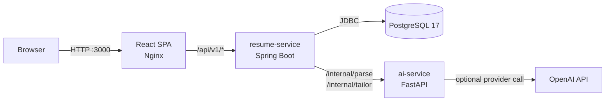
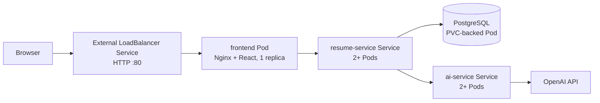

# TailorCV architecture

## Implemented local architecture (Phases 1–4)

Docker Compose runs the frontend, `resume-service`, `ai-service`, and PostgreSQL as separate containers. Only the frontend and Java API bind to `127.0.0.1`; Python and PostgreSQL remain on the private Compose network. The browser communicates only with Java through Nginx's `/api/` proxy.

### Responsibilities and data flow

1. The browser uploads a text-based PDF of at most 5 MB.
2. Java validates the file and extracts text with PDFBox.
3. Python converts the text to the strict canonical resume contract. The default parser is local and rule-based; optional AI parsing must be explicitly enabled.
4. Java validates and persists the original PDF, extracted text, and canonical JSON in PostgreSQL.
5. Java stores the job description and sends the selected resume and job text to Python for grounded tailoring.
6. Python asks the configured model to select source skills and experience bullets by index. It reconstructs and validates the result against the source before returning it.
7. Java persists the tailoring run. The result page displays the stored change summary and loads an escaped Thymeleaf preview.
8. Java renders the same template to PDF with OpenHTMLtoPDF. Export is generated in memory and is not persisted.

PostgreSQL is owned only by `resume-service`; `ai-service` is stateless. Java liveness checks only its process. Readiness also checks PostgreSQL and Python. Provider failures and timeouts are mapped to sanitized public errors.

## GKE deployment definition (Phase 6)

The GKE manifests use separate Deployments and Services for the frontend and both application services. Java and Python each have two replicas; the frontend has one. They have readiness/liveness probes, resource requests/limits, a ConfigMap, and a runtime-created Kubernetes Secret. A frontend `LoadBalancer` Service provides the only public entry point. PostgreSQL uses a 10 Gi `standard-rwo` persistent disk through a StatefulSet volume claim.

The project operator reports having run the cluster and tested rollout/rollback; the live cloud state has not been independently checked from this repository. A single frontend Pod and PostgreSQL Pod remain single points of failure, so this is not end-to-end high availability. During the live demonstration, verify the public workflow, scaling, Service endpoints, Pod replacement, rolling update, and rollback. Screenshots or logs are useful fallback material but are not a stated submission requirement.
